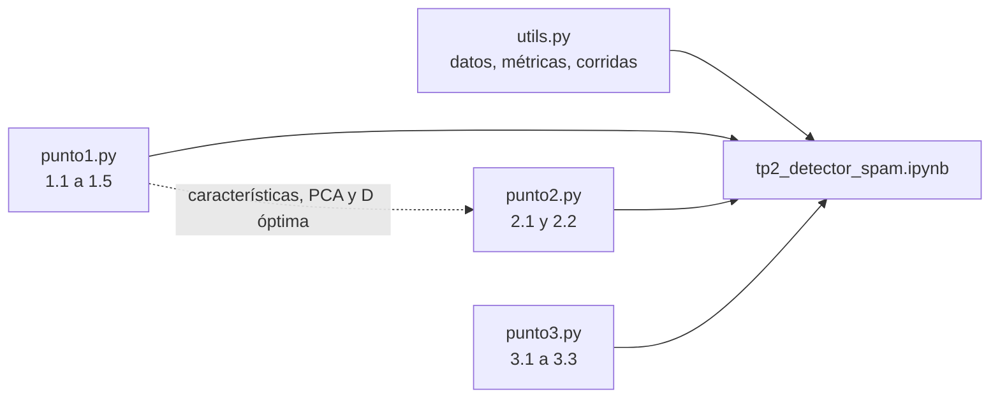

# TP2 - Detector de spam supervisado y no supervisado

Repositorio del Trabajo Práctico 2 del curso de Principios de Inteligencia
Artificial. El objetivo es detectar mensajes spam del dataset
[SMSSpamCollection](https://archive.ics.uci.edu/dataset/228/sms+spam+collection)
con regresión logística en PyTorch (con y sin PCA), detección de anomalías por
densidades de histograma y modelos grandes de lenguaje.

A diferencia del TP1, la implementación no vive dentro del notebook. Cada
punto del enunciado tiene su propio archivo en `src/tp2/` (`punto1.py`,
`punto2.py` y `punto3.py`), la infraestructura compartida está en `utils.py`,
y ningún archivo importa a otro. El notebook `notebooks/tp2_detector_spam.ipynb`
funciona como `main`: importa los archivos, los combina en los experimentos y
exporta figuras y tablas a `results/`, que el informe LaTeX de `docs/report/`
usa para responder el enunciado.

**Las tareas pendientes, las reglas del proyecto y los pasos para trabajar
están en [TODO.md](TODO.md) (personas) y [AGENTS.md](AGENTS.md) (agentes de
IA).**

## Entregables

- Notebook principal: `notebooks/tp2_detector_spam.ipynb`, junto con
  `src/tp2/` y `tests/`, de los que depende. Como el enunciado pide "un
  notebook", el `.zip` debe incluir también esas carpetas (igual que en el
  TP1 se entregó `utils.py`).
- Informe externo escrito en LaTeX: `docs/report/`.
- PDF final del informe, generado desde LaTeX.
- Documentación interna con formato Doxygen, generada desde una exportación
  temporal del notebook, los archivos de `src/tp2/` y las pruebas.

La fecha de entrega es el martes 20 de octubre de 2026; la lista completa está
en [TODO.md](TODO.md#checklist-de-entrega).

## Estructura

```text
AI-TP2/
├── AGENTS.md                   instrucciones para agentes de IA
├── TODO.md                     tareas, reglas y checklist de entrega (personas)
├── data/                       dataset descargado y cachés (excluidos de Git)
├── docs/
│   ├── assignment/             enunciado original
│   ├── doxygen/                portada de Doxygen
│   └── report/                 informe LaTeX, una sección por punto
├── notebooks/
│   └── tp2_detector_spam.ipynb notebook principal (main)
├── results/
│   ├── figures/                PNG exportados por el notebook
│   └── tables/                 CSV exportados por el notebook
├── src/tp2/
│   ├── punto1.py               1. regresión logística (1.1 a 1.5)
│   ├── punto2.py               2. detección de anomalías (2.1 y 2.2)
│   ├── punto3.py               3. modelos de lenguaje (3.1 a 3.3)
│   └── utils.py                datos, métricas, corridas, figuras y tablas
├── submission/                 copias finales para la entrega
└── tests/                      un archivo de pruebas por punto, más utils
```

## Mapa de puntos y archivos

| Punto | Archivo | Pruebas | Sección del informe | Estado |
|---|---|---|---|---|
| 1. Regresión logística (60) | `src/tp2/punto1.py` | `tests/test_punto1.py` | `01-punto1-regresion-logistica.tex` | 1.1 y 1.2 listos |
| 2. Detección de anomalías (30) | `src/tp2/punto2.py` | `tests/test_punto2.py` | `02-punto2-deteccion-anomalias.tex` | pendiente |
| 3. Modelos de lenguaje (10 + 20 extra) | `src/tp2/punto3.py` | `tests/test_punto3.py` | `03-punto3-modelos-lenguaje.tex` | pendiente |
| Infraestructura compartida | `src/tp2/utils.py` | `tests/test_utils.py` | — | listo |

`utils.py` ya incluye la carga del dataset, las particiones estratificadas
70/30, las muestras del 30 %, la tasa de aciertos, el F1-score, la repetición
de 30 corridas con tablas comparativas, la exportación de figuras y tablas, y
la ejecución de pruebas dentro del notebook. En los archivos de cada punto,
las funciones pendientes ya tienen su firma, su contrato documentado y un
`NotImplementedError` que indica el apartado que les corresponde.

## Por qué un archivo por punto

El proyecto se podría dividir en más archivos, pero con tres personas un
archivo por punto hace la asignación directa: cada persona es dueña de su
archivo, sus pruebas, su sección del notebook y su sección del informe, y los
conflictos de Git quedan limitados a la celda del notebook que integra su
parte.

El código de los tres puntos se puede escribir en paralelo. Las dependencias
que existen son de **resultados**, no de código, y se resuelven en el
notebook:



- El punto 2 necesita, para ejecutarse, las características (1.4), el PCA y
  la $D$ óptima (1.5). Se puede programar y probar antes con tensores
  sintéticos y una $D$ provisional.
- El punto 3 solo usa los textos originales y `utils.py`: es independiente.
- El punto 1 vale 60 puntos y es la ruta crítica.

## Preparación del entorno

Se necesita Python 3.11 o superior; las versiones de `requirements.txt` son
las validadas en el TP1 con Python 3.14. Los comandos usan el Python
instalado en el sistema: `py` en Windows y `python3` en macOS y Linux. Abrir
una terminal en la raíz del repositorio; si al inicio de la línea aparece
`(.venv)`, ejecutar primero `deactivate`.

### macOS y Linux

```bash
python3 -m pip install -r requirements.txt
python3 -c "import torch, pandas, matplotlib, pytest; print('ok')"
```

Si `python3` es anterior a 3.11, instalar una versión reciente desde
python.org y usar ese ejecutable (por ejemplo, `python3.14`). Si `pip`
responde `externally-managed-environment`, crear un entorno virtual con
`python3 -m venv .venv`, instalar con
`.venv/bin/python -m pip install -r requirements.txt` y usar
`.venv/bin/python` en lugar de `python3`.

### Windows PowerShell

```powershell
py -m pip install -r requirements.txt
py -c "import torch, pandas, matplotlib, pytest; print('ok')"
```

`requirements.txt` fija pandas 3.0.3 porque, con el Control inteligente de
aplicaciones de Windows 11, pandas 3.0.6 queda bloqueado al importarse.

En ambos casos, el último comando debe imprimir `ok`. Las dependencias de los
puntos 1.4 y 3 (`transformers`, `peft`, ...) están comentadas en
`requirements.txt` hasta que el equipo elija los modelos.

## Ejecución

Iniciar JupyterLab desde la raíz del repositorio con `py -m jupyter lab`
(Windows) o `python3 -m jupyter lab` (macOS y Linux), abrir
`notebooks/tp2_detector_spam.ipynb` con el kernel **Python 3 (ipykernel)** y
elegir **Kernel → Restart Kernel and Run All Cells…**.

- La primera ejecución descarga el dataset a `data/raw/`. Las características
  del codificador y las predicciones de los modelos de lenguaje se guardan en
  `data/processed/` para no recalcularlas.
- Mientras haya puntos pendientes, la ejecución se detiene en el primer
  `NotImplementedError` e indica qué apartado falta. El punto 3.3 (extra) se
  omite solo si `LORA_MODEL` no está definido.
- La sección **Pruebas unitarias** solo necesita la celda de configuración:
  se puede ejecutar en cualquier momento para ver el avance.

## Pruebas unitarias

Las pruebas también se ejecutan fuera del notebook:

```bash
python3 -m pytest
```

```powershell
py -m pytest
```

El resultado esperado en cada momento está en el "Estado actual" de
[TODO.md](TODO.md#estado-actual). Las pruebas sin implementar aparecen como
omitidas con el motivo `Pendiente`. `tests/test_module_independence.py` falla si un archivo de
`src/tp2/` importa a otro del paquete o si importa al inicio una dependencia
opcional.

## Documentación interna

Doxygen no consume el notebook directamente. Su fuente documentable se genera
de forma temporal y nunca se edita manualmente; `src/tp2/` y `tests/` se
incluyen directamente:

```bash
jupyter nbconvert --to python notebooks/tp2_detector_spam.ipynb --output tp2_detector_spam --output-dir build/doxygen-source
doxygen Doxyfile
```

La salida HTML queda en `build/doxygen/html/`. Tanto la exportación temporal
como la documentación generada se excluyen de Git.

## Informe externo

Con una distribución de LaTeX y `latexmk` instalados, ejecutar desde la raíz:

```bash
./build_pdf.sh
```

El script descarta los archivos intermedios y deja únicamente el PDF generado
en `submission/tp2_detector_spam.pdf`. (En el TP1 el script creaba
`submissions/` pero copiaba a `submission/`; aquí ambas rutas coinciden).

## Estado de verificación

- `pytest` y las celdas de configuración y de pruebas del notebook se
  ejecutaron correctamente en Windows con Python 3.14.
- La descarga del dataset real, la compilación del informe y Doxygen no se
  han probado todavía; ver [TODO.md](TODO.md#verificación-pendiente).

## Equipo

- Alejandro Quesada
- Manfred Azofeifa
- Jose Adrián Herrera
